# Johns Antony: Shopify Developer & E-commerce Specialist in Dubai, UAE

**I build, fix and grow Shopify stores for brands in the UAE and GCC.** Custom Shopify themes, Figma-to-Shopify builds, Tabby & Tamara payments, GA4 and Google Tag Manager tracking, Google Shopping feeds, and custom Next.js websites. All built mobile-first, SEO-ready and safe to publish.

📍 Dubai, UAE · 🌍 Available for remote freelance work worldwide · 🗣️ English, Malayalam, Hindi

[**Start a project →**](#contact) · [View e-commerce work](#e-commerce-projects) · [View custom builds](#custom-web--software-projects)

---

## At a Glance

| | |
|---|---|
| **Live Shopify storefronts managed** | 8+ brands (luxury fragrance, oud, flowers, lifestyle) |
| **Largest catalogue** | ~1,500 products · 130+ fragrance brands |
| **Domains & SSL certificates managed** | 30+ |
| **Online business accounts administered** | 30+ (ads, social, payments, Google) |
| **Experience** | 5+ years across e-commerce, web development, software QA and IT systems |
| **Markets** | UAE · GCC · AED storefronts · Arabic & English audiences |

---

## About Me

I'm **Johns Antony**, a **Shopify developer and digital e-commerce specialist based in Dubai**. I currently work as **Digital Specialist & E-commerce Shopify Developer at Maylaa International**, where I run the Shopify storefronts for a group of luxury fragrance, flower and lifestyle brands, including **Karji (The House of Karji), Atelier Perfumery, Flower District, Daima, Touch of Oud, Saleel Parfums, The Exceptional Parfums and Juvenis Paris**.

My day-to-day covers the whole e-commerce stack: **Shopify theme development in Liquid, Figma-to-Shopify implementation, payment gateways and Buy Now Pay Later (Tabby, Tamara), GA4 and GTM analytics, Google Merchant Center feeds, Google Ads, TikTok Ads and Google Business Profile**. It also covers the domains, SSL certificates, hosting and IT systems behind them.

Before e-commerce, I worked as a **Software QA Tester** and a **System Engineer**. That background shapes how I work today:

- **QA mindset:** every change is tested on mobile and desktop before it goes live.
- **Draft-first workflow:** I build on a duplicate theme, you preview it, then we publish. Your live store is never edited blind.
- **Systems thinking:** I fix root causes (broken markup, invalid forms, slow loading order), not just symptoms.

> **What clients get:** a developer who understands Shopify code, payments, tracking *and* the business side of running an online store in the UAE.

---

## Freelance Services

[Watch a storefront take shape, from Figma design to launch (14-second film)](public/videos/storefront-to-launch.mp4)

### 1. Shopify Store Development & Setup


New Shopify stores built from scratch or from a Figma design: theme setup, collections, navigation, product pages, policies, shipping zones, payments and launch checklist.
**Ideal for:** new brands, perfume and fashion start-ups, businesses moving to Shopify.

### 2. Shopify Theme Customisation (Liquid, CSS, JavaScript)


Custom sections and blocks editable from the theme editor, mega menus, brand pages, product page redesigns, cart and mini-cart features, sticky add-to-cart bars, carousels, mobile toolbars and filter panels.
**Ideal for:** stores that have outgrown their theme or need features apps can't deliver cleanly.

### 3. Figma to Shopify Conversion


Pixel-accurate, mobile-first conversion of Figma designs into Shopify themes, including motion, hover effects and page transitions, with every design option exposed in the theme editor so your team can edit without code.

### 4. Payments, BNPL & Checkout Optimisation


**Tabby and Tamara** promo widgets and integration, wallet buttons (Google Pay, Apple Pay, Shop Pay) styled to match your Add to Cart, discount code fields in the cart, payment links and payment gateway fixes.

### 5. Analytics, Tracking & Product Feeds


**GA4 e-commerce tracking through Google Tag Manager** (dataLayer from homepage to purchase), Shopify **Custom Pixels** for checkout and purchase events, and **XML product feeds for Google Merchant Center, Meta and TikTok** shopping campaigns.

### 6. Shopify Speed, SEO & Local SEO


Hero-first loading, smoother carousels, layout-shift fixes, SEO metafields, blog consolidation, clean collection URLs, breadcrumbs, and **Google Business Profile** setup with store landing pages for "near me" searches and Google Ads.

### 7. Custom Websites & Web Applications


Corporate websites and business web apps built with **Next.js, React, Node.js/Express and Prisma**, with admin panels, lead capture, SEO structured data and secure authentication.

### 8. Business Automation (n8n)


Lead generation, data enrichment, AI lead qualification, Google Sheets CRMs and outreach drafting workflows built in **n8n**, designed to run on free or low-cost tools.

### 9. Maintenance, Coming-Soon & Landing Pages


Fast, branded maintenance and coming-soon pages for Shopify, WordPress or cPanel-hosted domains, often delivered the same day.

### 10. Domains, SSL, Hosting & Technical Support


Domain and SSL purchase and renewal, DNS, cPanel hosting, business email setup and ongoing technical support for your online business.

---

## E-commerce Projects

> Store names are shared with permission as part of my role at Maylaa International. Internal IDs and credentials are omitted.

### Karji (The House of Karji) | karjistore.com
**Luxury fragrances, watches, accessories and gift sets · UAE · Shopify**

**The challenge:** A growing multi-brand catalogue needed cleaner collections, proper brand pages, multi-channel feeds and a full redesign from Figma.

**What I delivered:**
- **Full Figma-to-Shopify redesign** (mobile-first): motion from the Figma design, auto-sliding carousels, product-card hover effects and smooth page transitions
- **Mega menu** (New In, Perfumes, Home Fragrance, Gift Sets, All Brands) with nested SEO-friendly URLs such as `/collections/perfumes-for-women/eau-de-parfum-for-women`, and images editable in the theme editor
- **Brand system driven by a Shopify metaobject:** logo, banner (image or video), title, meta title and meta description per brand, with brand URLs as `/brands/brand-slug`
- **Smart collections:** out-of-stock products hidden, Watches showing watches only, New Arrivals auto-populated, plus a 30-day "New" label with the day count adjustable in the editor
- **Gift-with-purchase logic:** brand-specific free fragrance samples added to the cart automatically by gender and brand rules, shown as one grouped "Free samples" strip in the cart
- **Product page:** sticky autoplaying gallery, Tabby/Tamara "Split into 4 payments" box, WhatsApp and call contact options
- **Mobile UX:** bottom toolbar with wishlist and cart, glassmorphism Filter & Sort bar, accordion footer, filter groups collapsed by default, pagination with product count
- **Instagram section** fed by pasted post links and uploaded media (no heavy embeds)
- **Multi-channel XML product feed** (Google, Meta, TikTok), shipping rules (free above AED 200) and a fixed Order Printer invoice
- **Blog consolidation, article SEO metafields, Safari CSS Grid fix** and a three-layout policy page section with scrollspy table of contents

**Tech:** Shopify Liquid · Metaobjects · JavaScript · CSS · GTM · Google & YouTube channel
**Keywords:** luxury perfume Shopify store UAE, Shopify mega menu, Shopify metaobject brand pages, gift with purchase Shopify

---

### Atelier Perfumery | Luxury fragrance retailer, UAE
**~1,500 products · 130+ designer and niche fragrance brands · Shopify**

**The challenge:** A large catalogue with slow hero loading, misaligned product grids, placeholder product content and no proper tracking or feeds.

**What I delivered:**
- **Performance:** hero banner loads first and other sections follow; smoother carousels; single-line product titles to stop card misalignment
- **A–Z brand directory** with 132 brand logos served from the Shopify CDN, alphabetical filters and theme-editor layout options
- **Product page rebuild:** real descriptions replacing placeholders, auto-generated "Features" from Top / Middle / Base notes, and a Fragrance Palette with pyramid note icons
- **Wallet buttons** (Google Pay etc.) matched to Add to Cart size and shape on product and cart pages
- **Discount code field** in the mini cart and cart page, styled to the theme
- **GA4 dataLayer via Google Tag Manager** across the storefront, plus a **Shopify Custom Pixel** tracking begin_checkout, add_shipping_info, add_payment_info and purchase
- **Reusable Google Merchant Center XML feed** (RSS 2.0 + `g:` namespace) that works on any Shopify store by changing one config block
- **Full Figma rebuild (in progress):** a hand-built theme with in-place category switching (no page reload, shareable `?category=` URLs), a glassmorphic sticky Add to Cart bar, a floating "Filter & Sort" pill, Tabby + Tamara in one card, and split-layout brand pages

**Tech:** Shopify Liquid · JavaScript · GTM · GA4 · Shopify Customer Events / Custom Pixels · Google Merchant Center
**Keywords:** perfume e-commerce Shopify developer, Shopify GA4 tracking, Shopify Custom Pixel, Google Shopping feed Shopify

---

### Flower District | flowerdistrict.ae
**Luxury bouquets and bespoke events · UAE · Shopify · physical stores**

**The challenge:** Same-day and next-day flower delivery across seven emirates, with time slots, zone pricing and physical shops that needed local search traffic.

**What I delivered:**
- **Emirate-based delivery pricing** (AED 35 for the main emirates, AED 80 for remote areas, free above AED 250) handled through Shopify shipping rates, not cart line items
- **Date and time-slot delivery** with the Kite Pickup Delivery app, delivery estimates in the cart, and add-ons (message cards, balloons)
- **Cart-only checkout flow** (no buy-now buttons on product pages or the mini cart) and WhatsApp-only order updates
- **Mobile navigation** showing collection categories in the hamburger menu
- **Standalone store landing pages** (e.g. the Al Khawaneej store) with map, hours, call/WhatsApp and directions, built for Google Business Profile, local SEO and "near me" Google Ads
- **Wallet button alignment** and a **GA4 dataLayer across the full funnel**

**Tech:** Shopify · Liquid · Kite · Google Tag Manager · Google Ads · Google Business Profile
**Keywords:** flower delivery Shopify UAE, Shopify delivery date time slot, local SEO landing page Dubai florist

---

### Daima | daima.ae
**Fragrance & lifestyle brand · UAE · Shopify**

**The challenge:** The product page's Google Pay button was misaligned and some product blocks were rendering outside the product form.

**What I delivered:**
- **Root-cause fix:** found an invalid nested `<form>` in the theme's add-to-cart block that was breaking the layout and pushing blocks out of the form. Rebuilt it so the page has exactly one product form
- **Buy with Google Pay button** matched to the Add to Cart width, height, radius and font
- **Tabby + Tamara** BNPL blocks correctly placed in the product form
- **Blog migration** and theme maintenance
- **Coming-soon landing page** for Daima's new US branch (daimadubai.com)

**Tech:** Shopify Liquid · HTML/CSS · JavaScript
**Keywords:** Shopify add to cart bug fix, Shopify dynamic checkout button styling, Tabby Tamara Shopify

---

### Juvenis Paris | juvenisparis.com
**French-inspired fragrance brand · Shopify + static maintenance site**

**What I delivered:**
- **Separate mobile banner images** (with focal point and responsive `<picture>` markup) for the homepage scroll-collection sections
- **Tabby and Tamara widgets** directly under the buy buttons, with a layout fix so no gap appears in the left column
- **Price position setting** ("Below title") added to the section schema
- **Rewrote the mobile swipe interaction:** 1:1 finger tracking, momentum, axis-locking and a fix for the "swipe twice" bug, validated with a 13-scenario automated swipe test
- **Premium editorial maintenance page** (ivory, mocha and gold; Fraunces + Jost typography) hosted on cPanel

**Tech:** Shopify Liquid · GSAP · JavaScript · HTML/CSS · cPanel
**Keywords:** Shopify mobile banner, Shopify swipe carousel fix, Tabby Tamara product page widget

---

### Touch of Oud | touchofoud.com
**Oud and Arabian fragrance retailer · UAE · Shopify**

- Audited the live theme and menus, then built **dropdown navigation** for Perfume, Oud Tradition, Home Fragrance and Body Scent through the Shopify Admin GraphQL API, with no theme code changes needed
- Replaced tag-filtered URLs with **canonical collection URLs** for cleaner SEO
- Ongoing store management, feeds and campaign support

**Keywords:** Shopify navigation dropdown, Shopify GraphQL menu update, oud perfume online store

---

### Saleel Parfums · The Exceptional Parfums · Jouri Parfum
- **Saleel Parfums (saleelparfums.com):** homepage slideshow customisation on a preview-safe duplicate theme
- **The Exceptional Parfums:** ongoing Shopify store management, feeds and support
- **Jouri Parfum (jouriparfum.com):** branded maintenance page deployed to InMotion hosting (cPanel) and version-controlled on GitHub

---

### Multi-Store E-commerce Operations Toolkit
Tools I built to run several Shopify brands at once:
- **XML Feed Manager:** one workbook tracking 32 feeds (8 brands × Google Shopping, Google Local, Meta and TikTok) with a status dashboard and validation log
- **Portable code snippets:** single-file GTM dataLayer and XML feed templates that work on any store by changing one config value
- **Credential & domain tracker:** a register of projects, domains and SSL expiry dates with automatic warnings

---

## Custom Web & Software Projects

### Mechaura International | mechaurainternational.com
**B2B industrial machinery manufacturer & exporter · Full website rebuild**

- **Built with Next.js, React, Express and Prisma:** a server-rendered product catalogue organised by category, with technical spec-sheet tables and SEO structured data (Organization, Product, BreadcrumbList, FAQPage)
- **Lead capture:** enquiry and quote forms with spam protection and rate limiting
- **Secure admin panel:** JWT authentication and bcrypt password hashing, product management, and a lead inbox with CSV export
- Distinctive "industrial blueprint" design system

**Keywords:** B2B industrial website Next.js, product catalog website with admin panel, lead generation website UAE

---

### Mechaura B2B Lead Generation Automation (n8n)
**A 5-module AI lead-generation system built entirely on free tools**

1. **Lead Search Agent:** finds companies through Serper (Google Search) and Google Maps Places
2. **Lead Enrichment Agent:** adds contact and company details
3. **AI Qualification Agent:** scores leads against the ideal customer profile
4. **Google Sheets CRM:** organised pipeline with status tracking
5. **Outreach Assistant:** drafts personalised outreach

Targets procurement, engineering and operations decision-makers in manufacturing, automotive, construction, oil & gas, engineering and facility management across Dubai, Abu Dhabi, Sharjah, Ajman and Ras Al Khaimah.

**Keywords:** n8n lead generation workflow, B2B lead generation automation UAE, AI lead qualification

---

### Maylaa International Corporate Website
**Figma to Next.js · 13 sections · pixel-accurate**

- Converted the full Figma home page into **Next.js 15, React 19, TypeScript and Tailwind CSS**, with design tokens taken straight from Figma
- Fully responsive build with a typed codebase, a clean production build and an asset-download pipeline for Figma exports

**Keywords:** Figma to Next.js developer, corporate website Dubai, Tailwind CSS developer

---

### Internal Business Applications (Maylaa International)
Custom-built tools used daily by the business:
- **IT Assets Manager:** tracks company hardware, software and assignments
- **Finance App:** a Zoho Books-style application for invoicing and finance workflows
- **Domain & SSL Expiry Tracker:** monitors 30+ domains and certificates so nothing lapses

**Keywords:** custom business software Dubai, IT asset management app, SSL expiry monitoring tool

---

### NexEcoms | Multi-tenant e-commerce platform *(in development)*
A **multi-tenant e-commerce platform** where each client site connects its own Figma file. Chosen Figma frames are mapped to **editable section templates** in the backend, so designs become editable, reusable sections and not just static code.

**Keywords:** multi-tenant e-commerce platform, Figma to CMS, SaaS e-commerce builder

---

### Invitara | Interactive digital invitation platform
A premium **digital invitation platform** with cinematic guest experiences: **wax-seal breaking, storybook opening, scratch-to-reveal dates and gallery reveals**. Built for weddings and events, with regional needs such as Arabic RTL, Hijri dates and QR guest passes planned on the roadmap.

**Keywords:** digital wedding invitation website, interactive e-invitation platform, online invitation maker UAE

---

### DuooNex | Digital agency website
My **agency portfolio site**, where delivered projects are published as individual case studies.

### NexPixels | Animated coming-soon launch page
An immersive launch page built with **Three.js, GSAP and Anime.js**: an interactive 3D pixel-field background, logo reveal, live countdown and notify form, with reduced-motion and no-WebGL fallbacks for accessibility.

### Torque Moulds Factory | Corporate website *(in progress)*
Site plan, competitor review, section structure, design direction and high-fidelity wireframes for a Dubai (Al Quoz) tooling and mould supplier.

### Blue Ocean Fashion | blueocean.fashion
**WordPress** fashion site management, Namecheap domain administration and a custom navy, teal and gold maintenance-mode plugin.

### Mobile Applications
- **Pacifyr:** mobile application
- **ForWheels:** mobile application with a web admin panel

---

## Project notes

These summaries draw on my case notes. Each link opens the project.

**[Karji Store](https://karjistore.com/)** — I translated the Figma redesign into a mobile-first Shopify theme with editable brand pages, a mega menu and gift-with-purchase rules.

**[Daima](https://daima.ae/)** — I repaired a nested product form so Google Pay, Tabby and Tamara sit alongside the primary purchase action.

**[Flower District](https://flowerdistrict.ae/)** — I configured emirate-based delivery rates and delivery slots, then built individual store pages for local search.

**[Touch of Oud](https://touchofoud.com/)** — I rebuilt the fragrance navigation around canonical collection URLs so customers can browse oud, perfume, home fragrance and body scents.

**[Atelier Perfumery](https://atelierperfumery.com/)** — I worked on hero loading and product grids for a catalogue of about 1,500 products, and built an A–Z directory for more than 130 fragrance brands.

**[Juvenis Paris](https://juvenisparis.com/)** — I rebuilt the mobile swipe interaction, added responsive banner controls and positioned instalment options beneath the buy buttons.

**[The Exceptional Parfums](https://theexceptionalparfums.com/)** — I manage the Shopify storefront and maintain the product feeds that support shopping campaigns.

**[Saleel Parfums](https://saleelparfums.com/)** — I customised the homepage slideshow on a duplicate Shopify theme so the team could preview changes before publishing.

**[Nexpixels](https://nexpixels.com/)** — I built a coming-soon page with an interactive Three.js pixel field, a countdown and a notification form, with reduced-motion and no-WebGL fallbacks.

**[Torque](https://torque-production-51b4.up.railway.app/)** — For this mould supplier in Dubai, I developed the site structure, visual direction and high-fidelity wireframes for the corporate website.

**[Invitara](https://invitara-production.up.railway.app/)** — Invitara turns a digital invitation into an interactive reveal with a wax seal, a storybook opening and a scratch-to-reveal date.

---

## Work Experience

### Digital Specialist & E-commerce Shopify Developer, Maylaa International · Dubai, UAE
*Jun 2026 – Present*
- Own the group's **Shopify storefronts**: theme development, Figma implementation, collections, feeds, payments and tracking
- Set up and support **payment gateways, payment links, Tabby/Tamara BNPL** and network payment terminals
- Run **Google Ads and TikTok Ads** setup, billing and support; set up and verify **Google Business Profile** for new stores; support SEO work
- Build **custom corporate websites** and internal applications outside Shopify

### System Administrator, Maylaa International · Dubai, UAE
*Nov 2025 – May 2026*
- Managed **30+ domains and SSL certificates**, company social media and 30+ online business accounts
- Handled media and business software purchasing and updates
- Provided IT support, including urgent calls, to the **IT, Finance, Retail and HR** departments

### Software QA Tester, Ceino Technologies · Kozhikode, India
*Oct 2023 – Nov 2025*
- Manual and automated testing of web and mobile apps: functional, regression, system, usability and UAT
- Automation with **Selenium and Appium**; defect tracking in **Jira and Trello**; Agile/Scrum ceremonies

### System Engineer, Wiinnova Software Labs · Kerala, India
*Sep 2022 – May 2023*
- System maintenance, software installation, configuration, troubleshooting and deployment support

### IT Support & System Administration, Various Organisations · Kerala, India
*2021 – 2023*
- Network infrastructure, CCTV, biometric and access-control devices, PABX, firewalls, POS peripherals and endpoint security across multiple sites

---

## Skills & Tech Stack

| Area | Tools & Skills |
|---|---|
| **E-commerce** | Shopify, Shopify Liquid, Online Store 2.0 sections & blocks, Metafields, Metaobjects, Shopify Admin GraphQL API, Custom Pixels, WordPress |
| **Front-end** | HTML5, CSS3, JavaScript, React, Next.js, Tailwind CSS, TypeScript, GSAP, Three.js, Anime.js |
| **Back-end** | Node.js, Express, Prisma ORM, REST APIs, JWT authentication, SQL databases |
| **Design** | Figma, Figma-to-code, mobile-first responsive design, UI motion |
| **Analytics & Marketing** | GA4, Google Tag Manager, dataLayer, Google Merchant Center, Google Ads, TikTok Ads, Meta catalogue, Google Business Profile, on-page and local SEO |
| **Payments** | Tabby, Tamara, Shopify Payments, wallet buttons (Google Pay, Apple Pay, Shop Pay), payment links, network payment terminals |
| **Automation** | n8n, Google Sheets API, Serper, Google Maps Places API, AI agents |
| **Hosting & Infrastructure** | cPanel/WHM, DNS, domains, SSL, Vercel, Railway, GitHub, business email |
| **Quality Assurance** | Selenium, Appium, Jira, Trello, regression testing, cross-browser and mobile testing |
| **IT Systems** | Windows Server, Linux, networking (TCP/IP, DNS, DHCP, VPN), firewalls, CCTV, biometrics |

---

## How I Work

1. **Discovery call:** we go through your business, products, audience, payment methods and goals. I'll send a requirements questionnaire if needed.
2. **Plan & quote:** a clear scope, timeline and fixed price or hourly estimate.
3. **Build on a draft:** all work happens on a duplicate theme or staging site. Your live store keeps selling.
4. **Preview & test:** you review a preview link; I test on mobile, desktop and Safari.
5. **Publish & handover:** go live, a short walkthrough of the theme-editor settings, and documentation.
6. **Support:** optional monthly retainer for updates, campaigns and fixes.

---

## Why Clients Hire Me

- ✅ **UAE e-commerce experience:** AED pricing, emirate-based delivery, Tabby/Tamara, WhatsApp-first customers, Arabic & English audiences
- ✅ **Luxury retail focus:** perfume, oud, flowers, watches and lifestyle brands
- ✅ **Code and business together:** themes, payments, ads, tracking, feeds and domains in one person
- ✅ **No-risk workflow:** drafts and previews before anything touches your live store
- ✅ **Editable results:** settings exposed in the Shopify theme editor so your team doesn't depend on a developer for small changes
- ✅ **QA-tested delivery:** a background in software testing means fewer bugs after launch
- ✅ **Dubai time zone:** easy collaboration across the GCC, Europe and South Asia

---

## Frequently Asked Questions

### Do you work as a freelance Shopify developer in Dubai?
Yes. I take on freelance Shopify development, theme customisation and e-commerce projects for businesses in Dubai, the wider UAE, the GCC and internationally, either remotely or on-site in Dubai.

### Can you convert my Figma design into a Shopify theme?
Yes. I build mobile-first Shopify themes directly from Figma, including animations and hover effects, and make the sections editable in the Shopify theme editor.

### Can you add Tabby and Tamara to my Shopify store?
Yes. I've added and styled Tabby and Tamara instalment widgets on multiple UAE Shopify stores, placed correctly on product pages without breaking the layout.

### Can you set up GA4 and Google Tag Manager tracking on Shopify?
Yes. I set up a full GA4 e-commerce dataLayer through Google Tag Manager, from product views to add-to-cart, plus a Shopify Custom Pixel for checkout and purchase events.

### Can you create product feeds for Google Shopping, Meta and TikTok?
Yes. I build XML product feeds and set up Google Merchant Center so your products are eligible for Shopping ads and free listings.

### Will you edit my live store directly?
No. I work on a duplicate theme, share a preview link, and publish only after you approve.

### Do you build websites outside Shopify?
Yes. I build custom websites and web apps with Next.js, React, Node.js and Prisma, including admin panels, and also work with WordPress and static sites.

### Can you automate my lead generation or business workflows?
Yes. I build n8n automations for lead search, enrichment, AI qualification, Google Sheets CRMs and outreach drafting.

---

## Contact

**Let's build or grow your online store.**

- 📧 Email: **your-email@example.com** *(replace)*
- 📱 Phone / WhatsApp: **+971 58 810 2728**
- 💼 LinkedIn: [linkedin.com/in/johns-antony](https://linkedin.com/in/johns-antony)
- 💻 GitHub: [github.com/JohnzzzAntony](https://github.com/JohnzzzAntony)
- 🌐 Agency: **DuooNex**
- 📍 Dubai, United Arab Emirates

**Available for:** Shopify projects · Figma-to-Shopify builds · store audits & fixes · tracking & feeds · custom websites · n8n automation · monthly retainers

---
---

# Appendix: SEO Kit (not for on-page display)

## A. Primary & Secondary Keywords

**Primary (homepage):**
Shopify developer Dubai · freelance Shopify developer UAE · Shopify expert Dubai · e-commerce specialist Dubai

**Service pages:**
| Page | Primary keyword | Secondary keywords |
|---|---|---|
| Shopify Development | Shopify store development Dubai | Shopify store setup UAE, Shopify website design Dubai |
| Theme Customisation | Shopify theme customization | Shopify Liquid developer, custom Shopify sections |
| Figma to Shopify | Figma to Shopify conversion | Figma to Shopify developer, PSD to Shopify |
| Payments | Tabby Tamara Shopify integration | Shopify BNPL UAE, Shopify Apple Pay button styling |
| Tracking & Feeds | Shopify GA4 GTM setup | Shopify dataLayer, Google Merchant Center feed Shopify, TikTok catalogue Shopify |
| Speed & SEO | Shopify speed optimization | Shopify SEO UAE, Google Business Profile setup Dubai |
| Custom Web Apps | Next.js developer Dubai | custom web application UAE, website with admin panel |
| Automation | n8n automation expert | lead generation automation UAE, AI workflow automation |

**Long-tail / niche:**
perfume e-commerce website developer · luxury fragrance Shopify store · flower delivery website UAE · Shopify delivery date and time slot · Shopify gift with purchase · Shopify mega menu · Shopify metaobjects brand pages · Shopify maintenance page · coming soon page developer Dubai · multi-store Shopify management

## B. Case-Study Page Meta (for DuooNex / portfolio child pages)

| Slug | Meta title (≤60 chars) | Meta description (≤155 chars) |
|---|---|---|
| `/work/karji-shopify-redesign` | Karji Shopify Redesign: Figma to Shopify, UAE | Mobile-first Figma-to-Shopify redesign for luxury retailer Karji: mega menu, metaobject brand pages, gift-with-purchase and multi-channel feeds. |
| `/work/atelier-perfumery-shopify` | Atelier Perfumery: Shopify Perfume Store, UAE | 1,500-product perfume store: faster hero loading, 132-brand directory, GA4/GTM tracking, Custom Pixel and Google Shopping feed. |
| `/work/flower-district-shopify` | Flower District: Shopify Flower Delivery, UAE | Emirate-based delivery pricing, date/time slots, WhatsApp updates and local SEO store landing pages for a UAE florist on Shopify. |
| `/work/daima-shopify-fix` | Daima: Shopify Add to Cart & GPay Fix | Root-cause fix for a broken Shopify product form, plus Google Pay button alignment and Tabby/Tamara placement for Daima, UAE. |
| `/work/juvenis-paris-shopify` | Juvenis Paris: Shopify Mobile UX & BNPL | Mobile banners, Tabby/Tamara widgets and a rebuilt swipe carousel for fragrance brand Juvenis Paris on Shopify. |
| `/work/mechaura-website` | Mechaura: B2B Industrial Website in Next.js | Next.js B2B product catalogue with lead capture, secure admin panel and full SEO structured data for an industrial machinery exporter. |
| `/work/mechaura-n8n-lead-generation` | n8n B2B Lead Generation System, UAE | A 5-module n8n automation: lead search, enrichment, AI qualification, Google Sheets CRM and outreach drafting, built on free tools. |
| `/work/invitara` | Invitara: Interactive Digital Invitations | Premium e-invitation platform with wax-seal, storybook and scratch-to-reveal experiences for weddings and events. |
| `/work/nexecoms` | NexEcoms: Multi-tenant E-commerce Platform | Multi-tenant e-commerce platform that turns each client's Figma designs into editable backend sections. |

## C. Image Alt-Text Suggestions
- `karji-shopify-homepage-mobile.webp`: "Karji luxury perfume Shopify store homepage on mobile, designed by Johns Antony"
- `atelier-perfumery-brand-directory.webp`: "A–Z fragrance brand directory with 132 logos on the Atelier Perfumery Shopify store"
- `flower-district-delivery-slots.webp`: "Flower District cart with delivery date and time slot selection"
- `daima-product-page-gpay.webp`: "Daima product page with aligned Add to Cart and Google Pay buttons"
- `mechaura-admin-panel.webp`: "Mechaura International website admin panel lead inbox"
- `n8n-lead-generation-workflow.webp`: "n8n B2B lead generation workflow with AI qualification"

## D. Internal Linking Plan
- Homepage → each service section → matching case studies
- Every case study → "Services used" links → contact CTA
- FAQ answers → relevant service pages
- Anchor text examples: "Shopify theme customisation", "Figma to Shopify", "Tabby and Tamara integration", "GA4 tracking on Shopify"

## E. Structured Data (JSON-LD, paste into `<head>`)

```html
<script type="application/ld+json">
{
  "@context": "https://schema.org",
  "@graph": [
    {
      "@type": "Person",
      "@id": "https://YOUR-DOMAIN.com/#person",
      "name": "Johns Antony",
      "jobTitle": "Shopify Developer & E-commerce Specialist",
      "worksFor": { "@type": "Organization", "name": "Maylaa International" },
      "address": { "@type": "PostalAddress", "addressLocality": "Dubai", "addressCountry": "AE" },
      "url": "https://YOUR-DOMAIN.com/",
      "sameAs": [
        "https://www.linkedin.com/in/johns-antony",
        "https://github.com/JohnzzzAntony"
      ],
      "alumniOf": { "@type": "CollegeOrUniversity", "name": "Vinayaka Mission's Research Foundation" },
      "knowsLanguage": ["English", "Malayalam", "Hindi"],
      "knowsAbout": [
        "Shopify", "Shopify Liquid", "Figma to Shopify", "E-commerce",
        "Google Analytics 4", "Google Tag Manager", "Google Merchant Center",
        "Tabby", "Tamara", "Next.js", "React", "n8n", "SEO"
      ]
    },
    {
      "@type": "ProfessionalService",
      "@id": "https://YOUR-DOMAIN.com/#service",
      "name": "Johns Antony – Shopify & E-commerce Development",
      "description": "Freelance Shopify development, theme customisation, Figma to Shopify, payments, GA4/GTM tracking, product feeds, custom websites and n8n automation in Dubai, UAE.",
      "provider": { "@id": "https://YOUR-DOMAIN.com/#person" },
      "areaServed": ["AE", "SA", "QA", "KW", "BH", "OM", "Worldwide"],
      "address": { "@type": "PostalAddress", "addressLocality": "Dubai", "addressCountry": "AE" },
      "telephone": "+971588102728",
      "url": "https://YOUR-DOMAIN.com/",
      "hasOfferCatalog": {
        "@type": "OfferCatalog",
        "name": "Services",
        "itemListElement": [
          { "@type": "Offer", "itemOffered": { "@type": "Service", "name": "Shopify Store Development" } },
          { "@type": "Offer", "itemOffered": { "@type": "Service", "name": "Shopify Theme Customisation" } },
          { "@type": "Offer", "itemOffered": { "@type": "Service", "name": "Figma to Shopify Conversion" } },
          { "@type": "Offer", "itemOffered": { "@type": "Service", "name": "Tabby & Tamara Integration" } },
          { "@type": "Offer", "itemOffered": { "@type": "Service", "name": "GA4 & GTM E-commerce Tracking" } },
          { "@type": "Offer", "itemOffered": { "@type": "Service", "name": "Product Feeds for Google, Meta & TikTok" } },
          { "@type": "Offer", "itemOffered": { "@type": "Service", "name": "Custom Websites & Web Applications" } },
          { "@type": "Offer", "itemOffered": { "@type": "Service", "name": "n8n Business Automation" } }
        ]
      }
    },
    {
      "@type": "FAQPage",
      "mainEntity": [
        {
          "@type": "Question",
          "name": "Do you work as a freelance Shopify developer in Dubai?",
          "acceptedAnswer": { "@type": "Answer", "text": "Yes. I take on freelance Shopify development, theme customisation and e-commerce projects for businesses in Dubai, the UAE, the GCC and internationally." }
        },
        {
          "@type": "Question",
          "name": "Can you convert my Figma design into a Shopify theme?",
          "acceptedAnswer": { "@type": "Answer", "text": "Yes. I build mobile-first Shopify themes directly from Figma, including animations, with sections editable in the Shopify theme editor." }
        },
        {
          "@type": "Question",
          "name": "Can you add Tabby and Tamara to my Shopify store?",
          "acceptedAnswer": { "@type": "Answer", "text": "Yes. I have added and styled Tabby and Tamara instalment widgets on multiple UAE Shopify stores without breaking the product page layout." }
        },
        {
          "@type": "Question",
          "name": "Can you set up GA4 and Google Tag Manager tracking on Shopify?",
          "acceptedAnswer": { "@type": "Answer", "text": "Yes. I set up a full GA4 e-commerce dataLayer through Google Tag Manager plus a Shopify Custom Pixel for checkout and purchase events." }
        },
        {
          "@type": "Question",
          "name": "Will you edit my live Shopify store directly?",
          "acceptedAnswer": { "@type": "Answer", "text": "No. I work on a duplicate theme, share a preview link, and publish only after you approve." }
        }
      ]
    }
  ]
}
</script>
```

## F. Social & Freelance Profile Snippets

**LinkedIn / Upwork headline (≤120 chars):**
Shopify Developer & E-commerce Specialist | Figma to Shopify | GA4/GTM | Tabby & Tamara | Next.js | Dubai, UAE

**Fiverr / Upwork short bio (≈300 chars):**
Dubai-based Shopify developer running 8+ live storefronts for UAE luxury fragrance and lifestyle brands. I build custom Shopify themes from Figma, integrate Tabby/Tamara, set up GA4/GTM tracking and product feeds, and build Next.js websites and n8n automations. Draft-first, QA-tested, mobile-first.

**One-line pitch:**
I help UAE and GCC brands launch, fix and scale Shopify stores, from Figma design to tracked, paid and ranking.

---

<!-- PORTFOLIO-ASSETS:START -->

## G. Premium Portfolio — Real Projects & Original Asset Package

This section extends the supplied portfolio document. Its existing biography, case-study copy and implementation notes are preserved as supplied; they were not independently verified. The project URLs below come from Johns Antony's request. No client results, project screenshots or product interfaces have been invented.

### Visual direction

Use editorial typography, charcoal (#11120E), warm white (#F4F3EB), muted olive and a restrained lime accent (#D9FF83). Give actual website captures the largest space. Reserve chrome sculptures, isometric vectors and abstract motion for the personal brand, service explanations and section transitions. Never use them as project thumbnails, UI screenshots or evidence of client work.

The home and portfolio collections now use the 20 supplied URLs, and featured project cards on the services and contact pages use the same real catalog. The creative lab now shows original brand artwork rather than unrelated project interfaces. Until successful captures exist, project cards use typography and the real domain; they do not use stock images, fabricated screens or the repository's generic concept artwork. The previously existing CMS case studies retain their text but no longer substitute generic art for project images. No CMS database content was overwritten.

### Created assets — available now

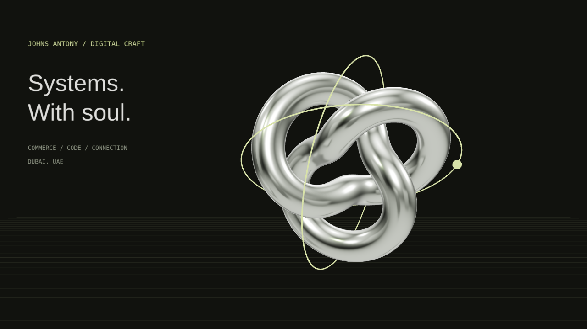

| Deliverable | Files | Intended placement |
| --- | --- | --- |
| Orbital Systems — original 3D animation | [MP4](public/videos/orbital-systems.mp4) · [WebM](public/videos/orbital-systems.webm) | Personal-brand motion study between the statement and work sections |
| Animation poster | [PNG, 1280 × 720](public/images/portfolio-art/orbital-systems.png) | Static fallback, reduced-motion experience, social/editorial use |
| Dimensional orbital mark | [SVG](public/images/portfolio-art/orbit-mark.svg) | About-page brand accent or identity detail |
| Connected Commerce | [SVG](public/images/portfolio-art/commerce-flow.svg) | Diagram supporting storefront, payments, analytics and operations services |
| Provenance | [Asset record](public/images/portfolio-art/provenance.json) | Identifies original procedural work and distinguishes it from project evidence |

The animation contains 144 rendered frames at 24 fps, is six seconds long, and is encoded in H.264 MP4 and VP9 WebM. Both files were decoded successfully with FFmpeg; dimensions and duration were checked with FFprobe. The poster was visually inspected. The artwork was constructed with Three.js geometry, materials and studio lighting, not downloaded client imagery. No external stock images were fetched or included.

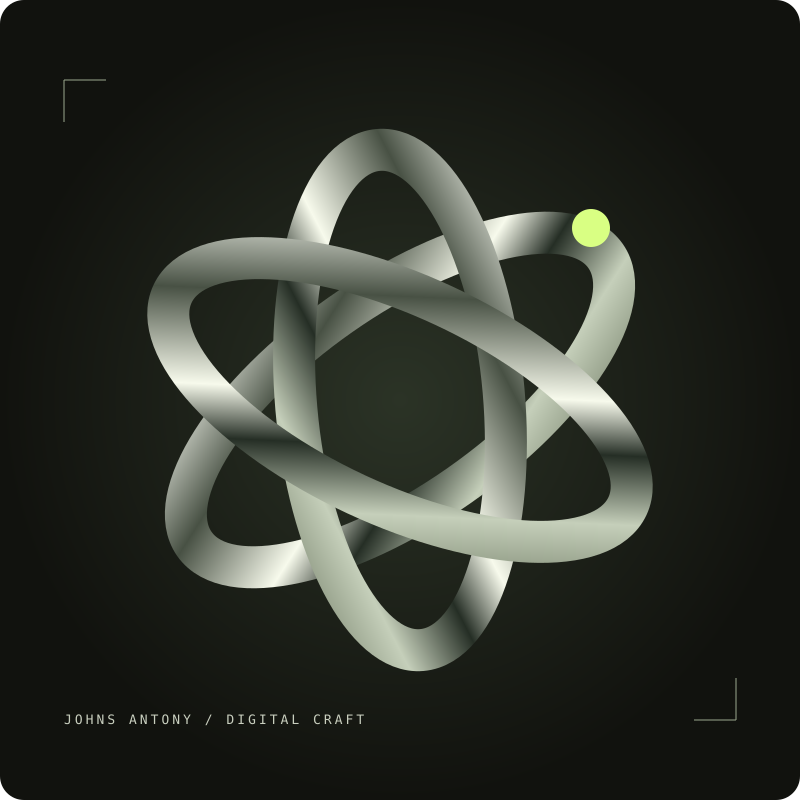

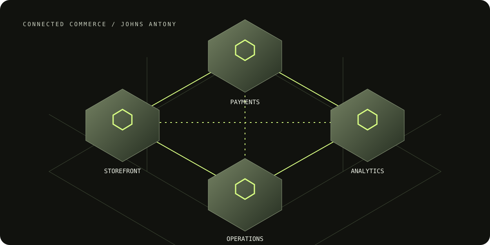

### Capture register — all 20 supplied URLs

Capture run: **2026-11-22T19:33:47.201Z**. Completed three-viewport captures: **0/20**.

The latest run attempted every URL with the environment's configured HTTPS client. A status of `network-policy-blocked` means the Cloud proxy returned CONNECT 403 before the site could load. It is not evidence that the website itself is down. No proxy error page was saved as a project screenshot. Browser captures, mockups and project reels remain pending for blocked entries.

| Real project URL | Observed result | Desktop · Tablet · Mobile | Mockup / video |
| --- | --- | --- | --- |
| [Karji Store](https://karjistore.com/) | network-policy-blocked | Not captured | Not generated |
| [Daima](https://daima.ae/) | network-policy-blocked | Not captured | Not generated |
| [Flower District](https://flowerdistrict.ae/) | network-policy-blocked | Not captured | Not generated |
| [Touch of Oud](https://touchofoud.com/) | network-policy-blocked | Not captured | Not generated |
| [Atelier Perfumery](https://atelierperfumery.com/) | network-policy-blocked | Not captured | Not generated |
| [Juvenis Paris](https://juvenisparis.com/) | network-policy-blocked | Not captured | Not generated |
| [The Exceptional Parfums](https://theexceptionalparfums.com/) | network-policy-blocked | Not captured | Not generated |
| [Saleel Parfums](https://saleelparfums.com/) | network-policy-blocked | Not captured | Not generated |
| [Nexpixels](https://nexpixels.com/) | network-policy-blocked | Not captured | Not generated |
| [New Fashion](https://new-fashion-production.up.railway.app/) | network-policy-blocked | Not captured | Not generated |
| [Elmoretto](https://elmoretto-production.up.railway.app/) | network-policy-blocked | Not captured | Not generated |
| [Torque](https://torque-production-51b4.up.railway.app/) | network-policy-blocked | Not captured | Not generated |
| [DB](https://db-production-8accfce3.up.railway.app/) | network-policy-blocked | Not captured | Not generated |
| [Ecommerce](https://ecommerce-production-f437.up.railway.app/) | network-policy-blocked | Not captured | Not generated |
| [Asset Manager](https://assetmanager-production-59c3.up.railway.app/) | network-policy-blocked | Not captured | Not generated |
| [DomSSL](https://domssl-production.up.railway.app/) | network-policy-blocked | Not captured | Not generated |
| [Nexora Ticketing](https://nexora-ticketing-1a23.up.railway.app/) | network-policy-blocked | Not captured | Not generated |
| [Books](https://books-production-9f40.up.railway.app/) | network-policy-blocked | Not captured | Not generated |
| [Work Manager](https://work-manager-production-1c98.up.railway.app/) | network-policy-blocked | Not captured | Not generated |
| [Invitara](https://invitara-production.up.railway.app/) | network-policy-blocked | Not captured | Not generated |

The malformed Asset Manager link in the request was normalized to the complete linked destination: https://assetmanager-production-59c3.up.railway.app/.

### Responsive capture and mockup specification

| Capture | CSS viewport | Outputs after a successful visit |
| --- | --- | --- |
| Desktop | 1440 × 1000 | Viewport PNG and full-page PNG |
| Tablet | 834 × 1112 | Viewport PNG and full-page PNG |
| Mobile | 390 × 844 | Viewport PNG and full-page PNG, touch enabled |
| Device composition | 1800 × 1200 | Perspective browser, tablet and phone frames containing those exact captures |
| Project motion reel | 1200 × 800, 24 fps | Six-second H.264 composition with a gentle camera move; clearly a presentation reel, not a recording of interactions |

Use the original page content. Do not replace real UI text, invent dashboard records or fill unavailable authenticated screens with fake data. Reject navigation errors, blank pages, common bot challenges and failed visible images. Record final URL, page title, date and viewport in the capture report. Review captures visually before publication; automated checks cannot establish that every lazy-loaded section looks correct. For sign-in pages, capture the public sign-in screen only; authenticated product views need a separately authorized session with private data excluded.

### Reproduce the work

Run from `/workspace/Portfolio-Template-` using Node 24, system Chromium and FFmpeg. Playwright is installed outside the checkout so this package does not alter application dependencies:

```sh
npm install --prefix /workspace/.portfolio-tools --cache /workspace/.npm --no-audit --no-fund playwright@1.58.2
node scripts/capture-projects.mjs
node scripts/build-project-mockups.mjs
node scripts/update-portfolio-assets-doc.mjs
```

The capture command exits nonzero if any site remains incomplete and writes a per-project report. After reviewing partial results, the mockup command can process entries marked `captured`; it refuses to make mockups when none are verified. The exact capture and mockup scripts were tested end to end against a temporary local HTML fixture: all three viewport/full-page pairs, the device composition and six-second MP4 were produced. The fixture and its outputs were removed and are not presented as client work. Successful external capture and real-project composition remain unverified because all destinations are blocked. The no-capture guard was also exercised.

To regenerate the original personal-brand 3D animation:

```sh
node scripts/render-portfolio-motion.mjs
```

That renderer was run successfully in this environment. It renders locally, without external image sources. Tool overrides are `PLAYWRIGHT_MODULE` (module file path/URL) and `CHROMIUM_PATH`. Retain all TLS, package-integrity and artifact-checksum verification.

### Motion and delivery rules

- The integrated brand video loads on approach, plays only while visible, pauses in a hidden tab, and respects `prefers-reduced-motion`. A keyboard-accessible pause control is included.
- Show the static poster for reduced motion. Keep the six-second loop muted. Project cards must remain useful without animations or thumbnails.
- Use responsive image sizes and lazy loading for project grids. Keep mobile screenshots readable with no text painted over the UI.
- Use factual case-study copy from the supplied document. Keep commerce work, software projects and supporting brand art visibly distinct.
- Preserve original full-page captures as evidence; export lighter delivery images only after reviewing the originals.

### What still needs access or verification

All 20 project domains and the likely `www` redirects for the nine custom domains are saved in the environment network draft, alongside the previously required `binaries.prisma.sh`. The user must review and save those settings before external capture can proceed. Additional image, font or script hosts may be revealed once the sites can load; record those exact failures before adding further domains.

No project screenshots, device mockups, project reels or fetched web images have been claimed as completed. The original brand animation and vectors are completed. Application lint passed with four pre-existing warnings. Full application typechecking, build and runtime checks remain blocked by missing generated Prisma types and the previously denied engine download; an isolated browser check of the actual new components passed: 20 correct project links, no substitute project images, reduced-motion behavior, pause/resume, offscreen pause and no browser errors. This is component validation, not a full application runtime check.

The supplied document still contains `YOUR-DOMAIN.com` and `your-email@example.com` placeholders. They were preserved rather than replaced with invented personal details. Draft environment changes are saved, not published. Publish the environment only after capture and application validation are complete.

<!-- PORTFOLIO-ASSETS:END -->
